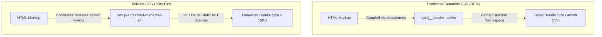
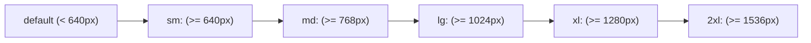
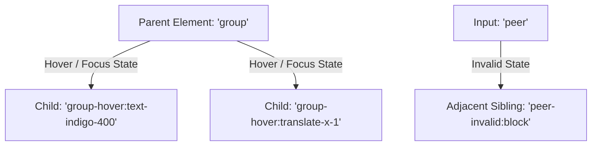
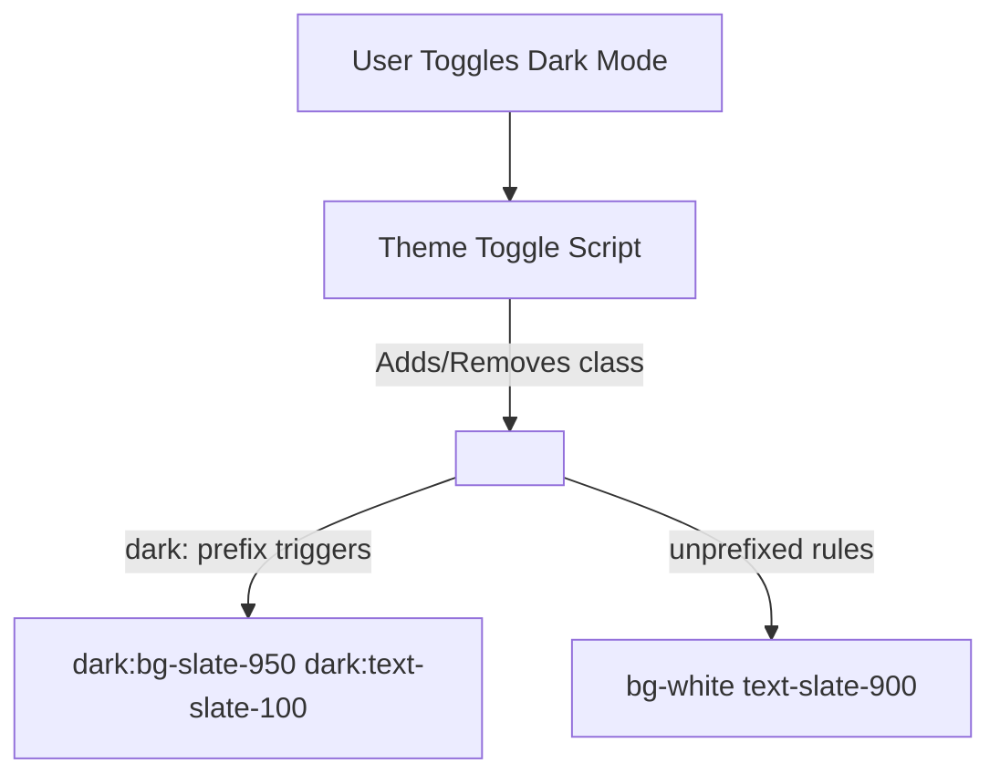

# Learn Tailwind CSS: From Zero to Staff Design Systems Engineer

[]()
[]()
[](LICENSE)

> A masterclass on modern utility-first CSS architecture, Tailwind CSS v4 Oxide engine, design tokens, Class Variance Authority (CVA), dark mode orchestration, and production web performance.

---

## Table of Contents
1. [Stage 1: Absolute Beginner Foundations & The Utility-First Architecture](#1-stage-1-absolute-beginner-foundations--the-utility-first-architecture)
2. [Stage 2: Core Utility Taxonomy & Responsive Layout Systems](#2-stage-2-core-utility-taxonomy--responsive-layout-systems)
3. [Stage 3: Pseudo-Variants, Parent-Child States & Container Queries](#3-stage-3-pseudo-variants-parent-child-states--container-queries)
4. [Stage 4: Dark Mode, OKLCH Theming & Design Token Engineering](#4-stage-4-dark-mode-oklch-theming--design-token-engineering)
5. [Stage 5: Component Encapsulation, CVA & The `cn()` Utility Pattern](#5-stage-5-component-encapsulation-cva--the-cn-utility-pattern)
6. [Stage 6: Tailwind v4 Oxide Engine, Plugins & Build Optimization](#6-stage-6-tailwind-v4-oxide-engine-plugins--build-optimization)
7. [Stage 7: Staff Frontend Interview Handbook & Production Cheatsheet](#7-stage-7-staff-frontend-interview-handbook--production-cheatsheet)

---

## Architectural Comparison: Semantic CSS vs. Utility-First CSS



---

## 1. Stage 1: Absolute Beginner Foundations & The Utility-First Architecture

### 1.1 The Shift from Semantic CSS to Atomic Utilities
In traditional Cascading Style Sheets, developers create semantic class names (e.g., `.user-profile-header`, `.btn-primary`). Over time, semantic stylesheets suffer from three critical flaws:
1. **Unbounded CSS Growth**: Every new feature requires new CSS rules, resulting in multi-megabyte stylesheets.
2. **Cascade & Specificity Collisions**: Modifying a rule in one stylesheet unintentionally breaks layouts across unrelated pages.
3. **Dead Code Accumulation**: Removing old UI components leaves behind unused styles due to fear of breaking hidden dependencies.

Tailwind CSS solves this through **Atomic Utilities**: highly focused, single-purpose classes that compose directly in your markup.

### 1.2 Line-by-Line Code Breakdown: Modern Component Card
Here is an atomic card component demonstrating spacing, typography, borders, shadows, and flex alignments:

```html
<div class="max-w-sm mx-auto p-6 bg-slate-900 border border-slate-800 rounded-2xl shadow-xl transition-all duration-300 hover:scale-[1.02] hover:border-indigo-500/50">
  <div class="flex items-center gap-4">
    <div class="relative w-12 h-12 rounded-full overflow-hidden ring-2 ring-indigo-500/30">
      
    </div>
    <div>
      <h3 class="text-base font-semibold text-slate-100 tracking-tight">Elena Rostova</h3>
      <p class="text-xs font-medium text-slate-400">Principal Systems Architect</p>
    </div>
  </div>
  <p class="mt-4 text-sm leading-relaxed text-slate-300">
    Architecting distributed fault-tolerant microservices and low-latency data pipelines.
  </p>
  <div class="mt-5 flex items-center justify-between pt-4 border-t border-slate-800">
    <span class="text-xs font-mono text-indigo-400">Active Node #4</span>
    <button class="px-3.5 py-1.5 text-xs font-medium text-white bg-indigo-600 rounded-lg hover:bg-indigo-500 focus-visible:outline-2 focus-visible:outline-offset-2 focus-visible:outline-indigo-500 transition-colors">
      View Telemetry
    </button>
  </div>
</div>
```

| Class Token | CSS Equivalent Property | Architectural Purpose |
| :--- | :--- | :--- |
| `max-w-sm mx-auto` | `max-width: 24rem; margin-inline: auto;` | Constrains card width and centers horizontally in parent. |
| `p-6` | `padding: 1.5rem;` | Consistent 24px inner padding based on 4px grid. |
| `bg-slate-900` | `background-color: #0f172a;` | Deep dark slate canvas background token. |
| `border border-slate-800` | `border-width: 1px; border-color: #1e293b;` | Subtle boundary separation without harsh contrast. |
| `rounded-2xl shadow-xl` | `border-radius: 1rem; box-shadow: ...;` | Modern elevated depth and rounded corner geometry. |
| `hover:scale-[1.02]` | `&:hover { transform: scale(1.02); }` | Subtle hover zoom micro-interaction. |

---

## 2. Stage 2: Core Utility Taxonomy & Responsive Layout Systems

### 2.1 The Mobile-First Breakpoint Matrix
Tailwind utilizes a strictly mobile-first responsive design philosophy: unprefixed classes apply to all screen sizes, while breakpoint prefixes apply to that breakpoint **and wider**.



### 2.2 Responsive Dashboard Grid Example
```html
<div class="grid grid-cols-1 gap-4 sm:grid-cols-2 lg:grid-cols-4">
  <div class="p-5 bg-slate-900 rounded-xl border border-slate-800">
    <span class="text-xs font-medium text-slate-400 uppercase tracking-wider">Total Requests</span>
    <p class="text-2xl font-bold text-slate-100 mt-1">12,849,204</p>
    <div class="mt-2 text-xs font-medium text-emerald-400 flex items-center gap-1">
      <span>+18.4%</span>
      <span class="text-slate-500">vs last week</span>
    </div>
  </div>
  <div class="p-5 bg-slate-900 rounded-xl border border-slate-800">
    <span class="text-xs font-medium text-slate-400 uppercase tracking-wider">P99 Latency</span>
    <p class="text-2xl font-bold text-slate-100 mt-1">14.2 ms</p>
    <div class="mt-2 text-xs font-medium text-emerald-400 flex items-center gap-1">
      <span>-2.1 ms</span>
      <span class="text-slate-500">within SLA</span>
    </div>
  </div>
  <div class="p-5 bg-slate-900 rounded-xl border border-slate-800">
    <span class="text-xs font-medium text-slate-400 uppercase tracking-wider">Error Rate</span>
    <p class="text-2xl font-bold text-slate-100 mt-1">0.0012%</p>
    <div class="mt-2 text-xs font-medium text-slate-400">Zero unhandled exceptions</div>
  </div>
  <div class="p-5 bg-slate-900 rounded-xl border border-slate-800">
    <span class="text-xs font-medium text-slate-400 uppercase tracking-wider">Active Workers</span>
    <p class="text-2xl font-bold text-slate-100 mt-1">64 / 64</p>
    <div class="mt-2 text-xs font-medium text-indigo-400">100% capacity</div>
  </div>
</div>
```

---

## 3. Stage 3: Pseudo-Variants, Parent-Child States & Container Queries

### 3.1 Parent-Child Styling with `group` and Sibling Logic with `peer`
Tailwind provides declarative state styling without custom JavaScript event handlers:



#### Production `group` Hover Card
```html
<a href="#details" class="group block p-6 bg-slate-900 rounded-xl border border-slate-800 hover:border-indigo-500/50 hover:bg-slate-800/60 transition-all">
  <div class="flex items-center justify-between">
    <span class="text-xs font-mono text-indigo-400 group-hover:text-indigo-300">DOCS-01</span>
    <svg class="w-4 h-4 text-slate-500 group-hover:text-indigo-400 group-hover:translate-x-1 transition-transform" fill="none" viewBox="0 0 24 24" stroke="currentColor">
      <path stroke-linecap="round" stroke-linejoin="round" stroke-width="2" d="M9 5l7 7-7 7" />
    </svg>
  </div>
  <h4 class="mt-3 text-lg font-semibold text-slate-100 group-hover:text-white">API Authentication</h4>
  <p class="mt-1 text-sm text-slate-400 group-hover:text-slate-300">Learn how to issue, rotate, and revoke JWT access tokens.</p>
</a>
```

#### Production Floating Label with `peer`
```html
<div class="relative">
  <input 
    type="email" 
    id="user_email" 
    placeholder=" "
    required 
    class="peer block w-full px-4 pt-6 pb-2 text-sm text-slate-100 bg-slate-900 border border-slate-700 rounded-lg focus:outline-none focus:border-indigo-500 focus:ring-1 focus:ring-indigo-500"
  />
  <label 
    for="user_email" 
    class="absolute text-xs text-slate-400 duration-150 transform -translate-y-3 scale-75 top-4 z-10 origin-[0] left-4 peer-placeholder-shown:scale-100 peer-placeholder-shown:translate-y-0 peer-placeholder-shown:text-sm peer-focus:scale-75 peer-focus:-translate-y-3 peer-focus:text-indigo-400 pointer-events-none"
  >
    Corporate Email Address
  </label>
  <p class="mt-1 hidden text-xs text-rose-400 peer-invalid:block">
    Please provide a valid email address.
  </p>
</div>
```

---

## 4. Stage 4: Dark Mode, OKLCH Theming & Design Token Engineering

### 4.1 Orchestrating Theme Switching: System vs. Manual Class Strategy
Tailwind supports both OS-level automatic dark mode (`prefers-color-scheme`) and manual user-toggleable class-based switching (`selector` strategy).



#### Complete Theme Toggle Script
```ts
// theme-switch.ts
export type Theme = 'light' | 'dark' | 'system';

export function initializeTheme() {
  const savedTheme = localStorage.getItem('app-theme') as Theme | null;
  const prefersDark = window.matchMedia('(prefers-color-scheme: dark)').matches;

  if (savedTheme === 'dark' || (!savedTheme && prefersDark)) {
    document.documentElement.classList.add('dark');
  } else {
    document.documentElement.classList.remove('dark');
  }
}

export function setTheme(theme: Theme) {
  if (theme === 'system') {
    localStorage.removeItem('app-theme');
    const prefersDark = window.matchMedia('(prefers-color-scheme: dark)').matches;
    document.documentElement.classList.toggle('dark', prefersDark);
  } else {
    localStorage.setItem('app-theme', theme);
    document.documentElement.classList.toggle('dark', theme === 'dark');
  }
}
```

---

## 5. Stage 5: Component Encapsulation, CVA & The `cn()` Utility Pattern

### 5.1 The `cn()` Helper: Safe Merging of Conflicting Classes
When building reusable React/Vue components, passing dynamic classes often causes specificity clashes (e.g., `p-4` passed to a component with default `p-2`). Native string concatenation cannot detect that `p-4` should override `p-2`.

We combine `clsx` (for conditional expressions) with `tailwind-merge` (for intelligent conflict resolution):

```ts
// src/lib/utils.ts
import { clsx, type ClassValue } from 'clsx';
import { twMerge } from 'tailwind-merge';

export function cn(...inputs: ClassValue[]): string {
  return twMerge(clsx(inputs));
}

// Example Conflict Resolution:
// cn('px-2 py-1 bg-red-500', 'px-4 bg-blue-600')
// -> 'py-1 px-4 bg-blue-600' (Intelligently removes px-2 and bg-red-500!)
```

### 5.2 Building Accessible Design Systems with Class Variance Authority (CVA)
```tsx
// src/components/Button.tsx
import * as React from 'react';
import { cva, type VariantProps } from 'class-variance-authority';
import { cn } from '../lib/utils';

const buttonVariants = cva(
  'inline-flex items-center justify-center rounded-lg font-medium text-sm transition-colors focus-visible:outline-none focus-visible:ring-2 focus-visible:ring-offset-2 disabled:opacity-50 disabled:pointer-events-none active:scale-[0.98]',
  {
    variants: {
      variant: {
        primary: 'bg-indigo-600 text-white hover:bg-indigo-500 focus-visible:ring-indigo-500 shadow-sm',
        secondary: 'bg-slate-800 text-slate-200 hover:bg-slate-700 focus-visible:ring-slate-400 border border-slate-700',
        danger: 'bg-rose-600 text-white hover:bg-rose-500 focus-visible:ring-rose-500 shadow-sm',
        ghost: 'text-slate-300 hover:bg-slate-800 hover:text-white',
        link: 'text-indigo-400 underline-offset-4 hover:underline p-0 h-auto',
      },
      size: {
        sm: 'h-8 px-3 text-xs gap-1.5',
        md: 'h-10 px-4 text-sm gap-2',
        lg: 'h-12 px-6 text-base gap-2.5',
        icon: 'h-10 w-10 p-0',
      },
    },
    defaultVariants: {
      variant: 'primary',
      size: 'md',
    },
  }
);

export interface ButtonProps
  extends React.ButtonHTMLAttributes<HTMLButtonElement>,
    VariantProps<typeof buttonVariants> {
  isLoading?: boolean;
}

export const Button = React.forwardRef<HTMLButtonElement, ButtonProps>(
  ({ className, variant, size, isLoading, children, disabled, ...props }, ref) => {
    return (
      <button
        ref={ref}
        disabled={disabled || isLoading}
        className={cn(buttonVariants({ variant, size, className }))}
        {...props}
      >
        {isLoading && (
          <svg className="animate-spin -ml-1 mr-2 h-4 w-4 text-current" fill="none" viewBox="0 0 24 24">
            <circle className="opacity-25" cx="12" cy="12" r="10" stroke="currentColor" strokeWidth="4" />
            <path className="opacity-75" fill="currentColor" d="M4 12a8 8 0 018-8V0C5.373 0 0 5.373 0 12h4z" />
          </svg>
        )}
        {children}
      </button>
    );
  }
);
Button.displayName = 'Button';
```

---

## 6. Stage 6: Tailwind v4 Oxide Engine, Plugins & Build Optimization

### 6.1 The Rust-Powered Oxide Engine & CSS-First Configuration
Tailwind CSS v4 introduces a ground-up rewrite in Rust (the Oxide engine), achieving build speeds up to **10x faster** than v3. 

In Tailwind v4, configuration moves directly into your primary stylesheet using native CSS `@theme` directives rather than JavaScript config files:

```css
/* app.css in Tailwind v4 */
@import "tailwindcss";

@theme {
  /* Design Tokens defined directly in CSS */
  --font-display: "Outfit", sans-serif;
  --font-mono: "JetBrains Mono", monospace;

  /* Custom Color Tokens using modern OKLCH */
  --color-brand-primary: oklch(0.65 0.22 260);
  --color-brand-accent: oklch(0.75 0.18 150);

  /* Extended Spacing System */
  --spacing-128: 32rem;
  --spacing-144: 36rem;

  /* Custom Animations */
  --animate-pulse-slow: pulse 4s cubic-bezier(0.4, 0, 0.6, 1) infinite;
}

/* Custom Reusable Utility */
@utility glass-card {
  background: color-mix(in oklch, var(--color-slate-900) 80%, transparent);
  backdrop-filter: blur(12px);
  border: 1px solid color-mix(in oklch, var(--color-slate-700) 40%, transparent);
  box-shadow: 0 8px 32px 0 rgba(0, 0, 0, 0.37);
}
```

---


---

## Comprehensive Production UI Component Gallery

### 1. Enterprise Sticky-Header Data Table with Pagination & Badges
A complete responsive table with zebra striping, status pills, and action dropdowns:

```html
<div class="w-full overflow-hidden rounded-xl border border-slate-800 bg-slate-900 shadow-xl">
  <!-- Table Header Controls -->
  <div class="flex flex-col gap-4 border-b border-slate-800 p-5 sm:flex-row sm:items-center sm:justify-between">
    <div>
      <h3 class="text-base font-semibold text-slate-100">Production Deployments</h3>
      <p class="text-xs text-slate-400 mt-1">Real-time status of microservices running across global clusters.</p>
    </div>
    <div class="flex items-center gap-3">
      <div class="relative">
        <input 
          type="text" 
          placeholder="Filter services..." 
          class="w-64 rounded-lg border border-slate-700 bg-slate-800/80 px-3.5 py-1.5 text-xs text-slate-200 placeholder-slate-400 focus:border-indigo-500 focus:outline-none focus:ring-1 focus:ring-indigo-500"
        />
      </div>
      <button class="flex items-center gap-1.5 rounded-lg bg-indigo-600 px-3 py-1.5 text-xs font-medium text-white hover:bg-indigo-500 transition-colors shadow-sm">
        <span>Deploy Pipeline</span>
      </button>
    </div>
  </div>

  <!-- Scrollable Table Body -->
  <div class="overflow-x-auto">
    <table class="w-full text-left text-xs text-slate-300">
      <thead class="border-b border-slate-800 bg-slate-950/60 font-mono text-[11px] uppercase tracking-wider text-slate-400">
        <tr>
          <th class="px-5 py-3.5">Service Name</th>
          <th class="px-5 py-3.5">Cluster / Region</th>
          <th class="px-5 py-3.5">Commit Hash</th>
          <th class="px-5 py-3.5">Status</th>
          <th class="px-5 py-3.5">P99 Latency</th>
          <th class="px-5 py-3.5 text-right">Actions</th>
        </tr>
      </thead>
      <tbody class="divide-y divide-slate-800/60">
        <tr class="hover:bg-slate-800/40 transition-colors">
          <td class="px-5 py-4 font-medium text-slate-100 flex items-center gap-2">
            <span class="h-2 w-2 rounded-full bg-emerald-400"></span>
            auth-service
          </td>
          <td class="px-5 py-4 font-mono text-slate-400">us-east-1 (N. Virginia)</td>
          <td class="px-5 py-4 font-mono text-indigo-400">f9d8a21</td>
          <td class="px-5 py-4">
            <span class="inline-flex items-center rounded-full bg-emerald-500/10 px-2.5 py-0.5 text-[11px] font-medium text-emerald-400 border border-emerald-500/20">
              Healthy
            </span>
          </td>
          <td class="px-5 py-4 font-mono">11.4 ms</td>
          <td class="px-5 py-4 text-right">
            <button class="text-slate-400 hover:text-slate-200 font-medium">Rollback</button>
          </td>
        </tr>
        <tr class="hover:bg-slate-800/40 transition-colors">
          <td class="px-5 py-4 font-medium text-slate-100 flex items-center gap-2">
            <span class="h-2 w-2 rounded-full bg-amber-400 animate-pulse"></span>
            payment-gateway
          </td>
          <td class="px-5 py-4 font-mono text-slate-400">eu-west-1 (Ireland)</td>
          <td class="px-5 py-4 font-mono text-indigo-400">3b4c120</td>
          <td class="px-5 py-4">
            <span class="inline-flex items-center rounded-full bg-amber-500/10 px-2.5 py-0.5 text-[11px] font-medium text-amber-400 border border-amber-500/20">
              Degraded
            </span>
          </td>
          <td class="px-5 py-4 font-mono text-amber-400">148.9 ms</td>
          <td class="px-5 py-4 text-right">
            <button class="text-slate-400 hover:text-slate-200 font-medium">Restart</button>
          </td>
        </tr>
      </tbody>
    </table>
  </div>
</div>
```

---

### 2. Glassmorphism Application Navigation Header
A modern navbar featuring backdrop blur, keyboard shortcut pill (`Cmd+K`), notification counter, and avatar:

```html
<header class="sticky top-0 z-40 w-full border-b border-slate-800/80 bg-slate-950/75 backdrop-blur-xl">
  <div class="mx-auto flex h-16 max-w-7xl items-center justify-between px-4 sm:px-6 lg:px-8">
    <!-- Brand Logo -->
    <div class="flex items-center gap-6">
      <a href="/" class="flex items-center gap-2.5">
        <div class="flex h-9 w-9 items-center justify-center rounded-xl bg-gradient-to-tr from-indigo-600 to-sky-500 shadow-md shadow-indigo-500/20">
          <span class="font-bold text-white text-base">H</span>
        </div>
        <span class="text-base font-bold tracking-tight text-white">HubScale</span>
      </a>
      <nav class="hidden md:flex items-center gap-1 text-sm font-medium text-slate-300">
        <a href="#overview" class="rounded-lg px-3 py-1.5 text-white bg-slate-800/60">Dashboard</a>
        <a href="#deployments" class="rounded-lg px-3 py-1.5 hover:text-white hover:bg-slate-800/40 transition-colors">Clusters</a>
        <a href="#security" class="rounded-lg px-3 py-1.5 hover:text-white hover:bg-slate-800/40 transition-colors">Security</a>
        <a href="#telemetry" class="rounded-lg px-3 py-1.5 hover:text-white hover:bg-slate-800/40 transition-colors">Telemetry</a>
      </nav>
    </div>

    <!-- Right Controls -->
    <div class="flex items-center gap-3">
      <!-- Search Input with Keyboard Shortcut -->
      <button class="hidden sm:flex items-center gap-3 rounded-lg border border-slate-700/60 bg-slate-900/80 px-3 py-1.5 text-xs text-slate-400 hover:border-slate-600 transition-colors">
        <span>Search metrics or logs...</span>
        <kbd class="rounded border border-slate-700 bg-slate-800 px-1.5 py-0.5 text-[10px] font-mono text-slate-300">⌘K</kbd>
      </button>

      <!-- Notification Bell -->
      <button class="relative rounded-lg p-2 text-slate-400 hover:bg-slate-800/60 hover:text-slate-200 transition-colors">
        <span class="absolute top-1.5 right-1.5 flex h-2 w-2">
          <span class="animate-ping absolute inline-flex h-full w-full rounded-full bg-indigo-400 opacity-75"></span>
          <span class="relative inline-flex rounded-full h-2 w-2 bg-indigo-500"></span>
        </span>
        <svg class="h-5 w-5" fill="none" viewBox="0 0 24 24" stroke="currentColor">
          <path stroke-linecap="round" stroke-linejoin="round" stroke-width="2" d="M15 17h5l-1.405-1.405A2.032 2.032 0 0118 14.158V11a6.002 6.002 0 00-4-5.659V5a2 2 0 10-4 0v.341C7.67 6.165 6 8.388 6 11v3.159c0 .538-.214 1.055-.595 1.436L4 17h5m6 0v1a3 3 0 11-6 0v-1m6 0H9" />
        </svg>
      </button>

      <!-- User Avatar -->
      <div class="h-8 w-8 rounded-full ring-2 ring-indigo-500/40 overflow-hidden">
        
      </div>
    </div>
  </div>
</header>
```

---

### 3. Slide-Over Drawer Modal with Backdrop Dimming
An accessible slide-over sheet used for inspector panels and settings drawers:

```html
<!-- Backdrop Container -->
<div class="fixed inset-0 z-50 overflow-hidden bg-slate-950/80 backdrop-blur-sm transition-opacity">
  <div class="fixed inset-y-0 right-0 flex max-w-full pl-10">
    <div class="w-screen max-w-md bg-slate-900 border-l border-slate-800 shadow-2xl flex flex-col justify-between">
      <!-- Drawer Header -->
      <div class="p-6 border-b border-slate-800 flex items-center justify-between">
        <div>
          <h3 class="text-base font-semibold text-slate-100">Node Configuration</h3>
          <p class="text-xs text-slate-400 mt-1">Adjust resource allocations and autoscaling limits.</p>
        </div>
        <button class="rounded-lg p-1.5 text-slate-400 hover:bg-slate-800 hover:text-white transition-colors">
          &times;
        </button>
      </div>

      <!-- Drawer Content Form -->
      <div class="p-6 space-y-5 overflow-y-auto flex-1">
        <div>
          <label class="block text-xs font-medium text-slate-300 mb-1.5">Node Instance Type</label>
          <select class="w-full rounded-lg border border-slate-700 bg-slate-800 px-3 py-2 text-xs text-slate-200 focus:border-indigo-500 focus:outline-none">
            <option>c6g.2xlarge (8 vCPU, 16 GiB Memory)</option>
            <option>c6g.4xlarge (16 vCPU, 32 GiB Memory)</option>
          </select>
        </div>

        <div>
          <label class="block text-xs font-medium text-slate-300 mb-1.5">Max Replicas</label>
          <input type="number" value="12" class="w-full rounded-lg border border-slate-700 bg-slate-800 px-3 py-2 text-xs text-slate-200 focus:border-indigo-500 focus:outline-none" />
        </div>

        <div>
          <label class="block text-xs font-medium text-slate-300 mb-1.5">Target CPU Utilization (%)</label>
          <input type="range" min="30" max="90" value="70" class="w-full accent-indigo-500" />
          <div class="flex justify-between text-[11px] text-slate-400 mt-1">
            <span>30% (Conservative)</span>
            <span>70% (Optimal)</span>
            <span>90% (Aggressive)</span>
          </div>
        </div>
      </div>

      <!-- Drawer Footer -->
      <div class="p-6 border-t border-slate-800 flex items-center justify-end gap-3 bg-slate-950/40">
        <button class="rounded-lg px-4 py-2 text-xs font-medium text-slate-300 hover:bg-slate-800 transition-colors">Cancel</button>
        <button class="rounded-lg bg-indigo-600 px-4 py-2 text-xs font-medium text-white hover:bg-indigo-500 transition-colors shadow-sm">Save Allocations</button>
      </div>
    </div>
  </div>
</div>
```


### 4. E-Commerce Product Detail Card with Variant Pills & Ratings
```html
<div class="mx-auto max-w-sm rounded-2xl border border-slate-800 bg-slate-900 p-5 shadow-xl transition-all duration-300 hover:border-slate-700">
  <!-- Product Image with Badge -->
  <div class="relative aspect-square w-full overflow-hidden rounded-xl bg-slate-950">
    
    <span class="absolute top-3 left-3 rounded-full bg-indigo-600/90 px-2.5 py-1 text-[11px] font-semibold text-white backdrop-blur-sm">
      Studio Edition
    </span>
  </div>

  <!-- Product Info -->
  <div class="mt-4">
    <div class="flex items-center justify-between">
      <span class="text-xs font-mono uppercase tracking-wider text-slate-400">Audio Hardware</span>
      <div class="flex items-center gap-1 text-amber-400">
        <svg class="h-3.5 w-3.5 fill-current" viewBox="0 0 20 20"><path d="M9.049 2.927c.3-.921 1.603-.921 1.902 0l1.07 3.292a1 1 0 00.95.69h3.462c.969 0 1.371 1.24.588 1.81l-2.8 2.034a1 1 0 00-.364 1.118l1.07 3.292c.3.921-.755 1.688-1.54 1.118l-2.8-2.034a1 1 0 00-1.175 0l-2.8 2.034c-.784.57-1.838-.197-1.539-1.118l1.07-3.292a1 1 0 00-.364-1.118L2.98 8.72c-.783-.57-.38-1.81.588-1.81h3.461a1 1 0 00.951-.69l1.07-3.292z"/></svg>
        <span class="text-xs font-bold text-slate-200">4.9</span>
        <span class="text-[11px] text-slate-500">(128)</span>
      </div>
    </div>
    <h3 class="mt-1 text-base font-semibold text-slate-100">Apex Wireless Planar Monitors</h3>
    <p class="mt-1 text-xs text-slate-400 line-clamp-2">Ultra-low distortion planar magnetic drivers with active spatial acoustic calibration.</p>
  </div>

  <!-- Color Variant Pills -->
  <div class="mt-4 flex items-center gap-2">
    <button class="h-5 w-5 rounded-full bg-slate-900 ring-2 ring-indigo-500 ring-offset-2 ring-offset-slate-900"></button>
    <button class="h-5 w-5 rounded-full bg-slate-400 hover:ring-2 hover:ring-slate-400 hover:ring-offset-2 hover:ring-offset-slate-900 transition-all"></button>
    <button class="h-5 w-5 rounded-full bg-amber-700 hover:ring-2 hover:ring-amber-700 hover:ring-offset-2 hover:ring-offset-slate-900 transition-all"></button>
  </div>

  <!-- Price & Purchase Action -->
  <div class="mt-5 flex items-center justify-between pt-4 border-t border-slate-800">
    <div>
      <span class="text-[11px] text-slate-500 line-through">$399.00</span>
      <p class="text-lg font-bold text-white">$329.00</p>
    </div>
    <button class="flex items-center gap-1.5 rounded-lg bg-indigo-600 px-4 py-2 text-xs font-semibold text-white shadow-md shadow-indigo-600/30 hover:bg-indigo-500 transition-colors active:scale-95">
      <span>Add to Cart</span>
    </button>
  </div>
</div>
```

---

### 5. Cloud Telemetry Metrics Sparkline Grid
```html
<div class="grid grid-cols-1 gap-4 sm:grid-cols-2 lg:grid-cols-3">
  <div class="rounded-xl border border-slate-800 bg-slate-900 p-5">
    <div class="flex items-center justify-between">
      <span class="text-xs font-medium uppercase tracking-wider text-slate-400">Database IOPS</span>
      <span class="rounded bg-indigo-500/10 px-2 py-0.5 font-mono text-[10px] text-indigo-400">Aurora PG</span>
    </div>
    <div class="mt-2 flex items-baseline gap-2">
      <span class="text-2xl font-bold text-white">48,290</span>
      <span class="text-xs font-medium text-emerald-400">↑ 12% peak</span>
    </div>
    <div class="mt-4 h-10 w-full overflow-hidden">
      <!-- Simulated SVG Sparkline Curve -->
      <svg class="h-full w-full stroke-indigo-500 stroke-2 fill-none" viewBox="0 0 100 25" preserveAspectRatio="none">
        <path d="M0 20 Q 20 5, 40 18 T 80 8 T 100 4" />
      </svg>
    </div>
  </div>

  <div class="rounded-xl border border-slate-800 bg-slate-900 p-5">
    <div class="flex items-center justify-between">
      <span class="text-xs font-medium uppercase tracking-wider text-slate-400">Edge Cache Hit Ratio</span>
      <span class="rounded bg-emerald-500/10 px-2 py-0.5 font-mono text-[10px] text-emerald-400">Cloudflare</span>
    </div>
    <div class="mt-2 flex items-baseline gap-2">
      <span class="text-2xl font-bold text-white">99.4%</span>
      <span class="text-xs font-medium text-slate-400">Bandwidth saved: 4.8 TB</span>
    </div>
    <div class="mt-4 h-10 w-full overflow-hidden">
      <svg class="h-full w-full stroke-emerald-400 stroke-2 fill-none" viewBox="0 0 100 25" preserveAspectRatio="none">
        <path d="M0 15 Q 30 14, 50 10 T 80 5 T 100 3" />
      </svg>
    </div>
  </div>

  <div class="rounded-xl border border-slate-800 bg-slate-900 p-5">
    <div class="flex items-center justify-between">
      <span class="text-xs font-medium uppercase tracking-wider text-slate-400">TLS Handshake Time</span>
      <span class="rounded bg-sky-500/10 px-2 py-0.5 font-mono text-[10px] text-sky-400">Global P95</span>
    </div>
    <div class="mt-2 flex items-baseline gap-2">
      <span class="text-2xl font-bold text-white">8.6 ms</span>
      <span class="text-xs font-medium text-emerald-400">TLS 1.3 0-RTT</span>
    </div>
    <div class="mt-4 h-10 w-full overflow-hidden">
      <svg class="h-full w-full stroke-sky-400 stroke-2 fill-none" viewBox="0 0 100 25" preserveAspectRatio="none">
        <path d="M0 12 Q 25 18, 50 14 T 75 16 T 100 9" />
      </svg>
    </div>
  </div>
</div>
```


### 6. Enterprise Settings & API Key Management Portal
```html
<div class="mx-auto max-w-4xl space-y-8 rounded-2xl border border-slate-800 bg-slate-900 p-8 shadow-2xl">
  <!-- Section 1: Profile Information -->
  <div class="border-b border-slate-800 pb-8">
    <h3 class="text-lg font-bold text-white">Organization Profile</h3>
    <p class="text-xs text-slate-400 mt-1">This information will be displayed across team workspace invitations.</p>

    <div class="mt-6 grid grid-cols-1 gap-6 sm:grid-cols-2">
      <div>
        <label class="block text-xs font-semibold text-slate-300 mb-2">Team Name</label>
        <input 
          type="text" 
          value="Core Platform Engineering" 
          class="w-full rounded-lg border border-slate-700 bg-slate-800/90 px-4 py-2 text-sm text-slate-100 placeholder-slate-500 focus:border-indigo-500 focus:outline-none focus:ring-1 focus:ring-indigo-500"
        />
      </div>

      <div>
        <label class="block text-xs font-semibold text-slate-300 mb-2">Billing Contact Email</label>
        <input 
          type="email" 
          value="billing-core@platform.internal" 
          class="w-full rounded-lg border border-slate-700 bg-slate-800/90 px-4 py-2 text-sm text-slate-100 placeholder-slate-500 focus:border-indigo-500 focus:outline-none focus:ring-1 focus:ring-indigo-500"
        />
      </div>

      <div class="sm:col-span-2">
        <label class="block text-xs font-semibold text-slate-300 mb-2">Organization Slug</label>
        <div class="flex rounded-lg shadow-sm">
          <span class="inline-flex items-center rounded-l-lg border border-r-0 border-slate-700 bg-slate-800 px-3 text-xs text-slate-400">
            https://hubscale.io/org/
          </span>
          <input 
            type="text" 
            value="core-platform" 
            class="w-full rounded-r-lg border border-slate-700 bg-slate-800/90 px-4 py-2 text-sm text-slate-100 placeholder-slate-500 focus:border-indigo-500 focus:outline-none focus:ring-1 focus:ring-indigo-500"
          />
        </div>
      </div>
    </div>
  </div>

  <!-- Section 2: API Keys Management Table -->
  <div class="border-b border-slate-800 pb-8">
    <div class="flex items-center justify-between">
      <div>
        <h3 class="text-lg font-bold text-white">API Authentication Keys</h3>
        <p class="text-xs text-slate-400 mt-1">Secret tokens used to authenticate CI/CD deployment agents and telemetry pipelines.</p>
      </div>
      <button class="flex items-center gap-1.5 rounded-lg bg-indigo-600 px-3.5 py-2 text-xs font-semibold text-white hover:bg-indigo-500 transition-colors shadow-sm">
        <span>Generate New Key</span>
      </button>
    </div>

    <div class="mt-6 overflow-hidden rounded-xl border border-slate-800 bg-slate-950/60">
      <table class="w-full text-left text-xs text-slate-300">
        <thead class="border-b border-slate-800 bg-slate-900/90 font-mono text-[11px] uppercase tracking-wider text-slate-400">
          <tr>
            <th class="px-4 py-3">Key Label</th>
            <th class="px-4 py-3">Token Prefix</th>
            <th class="px-4 py-3">Permissions</th>
            <th class="px-4 py-3">Created Date</th>
            <th class="px-4 py-3 text-right">Revocation</th>
          </tr>
        </thead>
        <tbody class="divide-y divide-slate-800/80">
          <tr>
            <td class="px-4 py-3.5 font-medium text-white">github-actions-prod</td>
            <td class="px-4 py-3.5 font-mono text-indigo-400">hb_live_99d1...</td>
            <td class="px-4 py-3.5">
              <span class="rounded bg-indigo-500/10 px-2 py-0.5 font-mono text-[10px] text-indigo-400">deploy:write</span>
            </td>
            <td class="px-4 py-3.5 text-slate-400">Sep 14, 2026</td>
            <td class="px-4 py-3.5 text-right">
              <button class="text-rose-400 hover:text-rose-300 font-medium">Revoke</button>
            </td>
          </tr>
          <tr>
            <td class="px-4 py-3.5 font-medium text-white">datadog-metrics-agent</td>
            <td class="px-4 py-3.5 font-mono text-indigo-400">hb_live_14a0...</td>
            <td class="px-4 py-3.5">
              <span class="rounded bg-sky-500/10 px-2 py-0.5 font-mono text-[10px] text-sky-400">metrics:read</span>
            </td>
            <td class="px-4 py-3.5 text-slate-400">Aug 02, 2026</td>
            <td class="px-4 py-3.5 text-right">
              <button class="text-rose-400 hover:text-rose-300 font-medium">Revoke</button>
            </td>
          </tr>
        </tbody>
      </table>
    </div>
  </div>

  <!-- Section 3: Danger Zone -->
  <div class="rounded-xl border border-rose-900/40 bg-rose-950/10 p-6">
    <div class="flex flex-col sm:flex-row sm:items-center sm:justify-between gap-4">
      <div>
        <h4 class="text-sm font-bold text-rose-300">Delete Organization Workspace</h4>
        <p class="text-xs text-rose-400/80 mt-1">Permanently remove all clusters, telemetry logs, and billing subscriptions. This action cannot be undone.</p>
      </div>
      <button class="rounded-lg border border-rose-600/50 bg-rose-600/20 px-4 py-2 text-xs font-semibold text-rose-300 hover:bg-rose-600 hover:text-white transition-colors">
        Delete Workspace
      </button>
    </div>
  </div>
</div>


### 7. Interactive Accordion FAQ Disclosure Widget
A pure CSS or interactive accessible disclosure widget with animated expansion chevrons:

```html
<div class="mx-auto max-w-3xl divide-y divide-slate-800 rounded-2xl border border-slate-800 bg-slate-900 shadow-xl">
  <!-- FAQ Item 1 -->
  <details class="group p-6" open>
    <summary class="flex cursor-pointer list-none items-center justify-between font-semibold text-slate-100 transition-colors hover:text-indigo-400">
      <span class="text-sm sm:text-base">How does Tailwind v4 handle CSS purging compared to Tailwind v3?</span>
      <span class="ml-4 flex h-7 w-7 items-center justify-center rounded-full bg-slate-800 text-slate-400 group-open:rotate-180 group-open:bg-indigo-600/20 group-open:text-indigo-400 transition-transform duration-300">
        <svg class="h-4 w-4" fill="none" viewBox="0 0 24 24" stroke="currentColor">
          <path stroke-linecap="round" stroke-linejoin="round" stroke-width="2" d="M19 9l-7 7-7-7" />
        </svg>
      </span>
    </summary>
    <p class="mt-4 text-xs sm:text-sm leading-relaxed text-slate-400">
      Tailwind v4 features the Oxide Rust compiler, which scans project files using parallelized AST extraction. Unlike v3 which relied on JavaScript PostCSS plugins, v4 generates CSS rules on the fly with zero disk cache overhead and up to 10x faster compilation cycles.
    </p>
  </details>

  <!-- FAQ Item 3 -->
  <details class="group p-6">
    <summary class="flex cursor-pointer list-none items-center justify-between font-semibold text-slate-100 transition-colors hover:text-indigo-400">
      <span class="text-sm sm:text-base">How should design teams handle custom brand fonts with Tailwind?</span>
      <summary-icon class="ml-4 flex h-7 w-7 items-center justify-center rounded-full bg-slate-800 text-slate-400 group-open:rotate-180 group-open:bg-indigo-600/20 group-open:text-indigo-400 transition-transform duration-300">
        <svg class="h-4 w-4" fill="none" viewBox="0 0 24 24" stroke="currentColor">
          <path stroke-linecap="round" stroke-linejoin="round" stroke-width="2" d="M19 9l-7 7-7-7" />
        </svg>
      </summary-icon>
    </summary>
    <p class="mt-4 text-xs sm:text-sm leading-relaxed text-slate-400">
      In Tailwind v4, declare custom font families inside the <code>@theme</code> block using CSS custom properties: <code>--font-display: "Cabinet Grotesk", sans-serif;</code>. You can then immediately apply <code>font-display</code> across any HTML or JSX element with zero JavaScript configuration.
    </p>
  </details>

  <!-- FAQ Item 2 -->
  <details class="group p-6">
    <summary class="flex cursor-pointer list-none items-center justify-between font-semibold text-slate-100 transition-colors hover:text-indigo-400">
      <span class="text-sm sm:text-base">Can Tailwind CSS be safely used with Shadow DOM or Web Components?</span>
      <span class="ml-4 flex h-7 w-7 items-center justify-center rounded-full bg-slate-800 text-slate-400 group-open:rotate-180 group-open:bg-indigo-600/20 group-open:text-indigo-400 transition-transform duration-300">
        <svg class="h-4 w-4" fill="none" viewBox="0 0 24 24" stroke="currentColor">
          <path stroke-linecap="round" stroke-linejoin="round" stroke-width="2" d="M19 9l-7 7-7-7" />
        </svg>
      </span>
    </summary>
    <p class="mt-4 text-xs sm:text-sm leading-relaxed text-slate-400">
      Yes! By injecting the compiled Tailwind stylesheet into the Custom Element's <code>adoptedStyleSheets</code> array (using <code>CSSStyleSheet()</code>), the Web Component gains full access to all utility classes without leaking styles into the host page.
    </p>
  </details>
</div>


## 7. Stage 7: Staff Frontend Interview Handbook & Production Cheatsheet

### 50 Staff-Level Tailwind CSS Interview Questions & Answers

#### Q1: Why does Tailwind CSS achieve a plateaued CSS bundle size while traditional CSS scales linearly?
**Answer:** Traditional CSS scales linearly $O(N)$ with feature additions because developers create unique class selectors for every new component. In contrast, Tailwind generates atomic utilities. As an application grows from 10 to 1,000 components, new components reuse existing utility classes (`flex`, `p-4`, `text-sm`, `rounded`). The production CSS bundle caps at the finite permutation of utilities used (typically 8KB–15KB gzipped).

#### Q2: What is the purpose of `tailwind-merge` and why is string concatenation (`clsx`) insufficient for component styling?
**Answer:** `clsx` conditionally concatenates class strings, but cannot parse CSS property conflicts. If a base component has `p-2` and a parent passes `p-4`, `clsx('p-2', 'p-4')` yields `"p-2 p-4"`. In CSS, which padding wins depends entirely on source order in the generated stylesheet, not order in the `class` attribute. `tailwind-merge` understands Tailwind's utility taxonomy and removes preceding conflicting classes (`p-2`), guaranteeing predictable overrides.

#### Q3: How does the JIT (Just-In-Time) compiler scan files for class names?
**Answer:** The JIT compiler uses regular expressions to extract candidate tokens from source files without evaluating JavaScript execution. It parses strings against known utility patterns (e.g., `bg-blue-500`, `text-[13px]`). Consequently, dynamically constructed classes like ``bg-${color}-500`` cannot be parsed at build time and must be declared in full or safelisted.

#### Q4: How does Tailwind v4 differ from Tailwind v3 in configuration architecture?
**Answer:** Tailwind v3 relied on JavaScript-based configuration (`tailwind.config.js`) and PostCSS plugins. Tailwind v4 adopts a CSS-first approach where themes, tokens, and font families are configured via native `@theme` directives directly in CSS. Furthermore, v4 replaces the Node-based parser with the Rust-based Oxide engine for instantaneous AST scanning.

#### Q5: What are the performance implications of using arbitrary values like `top-[17px]`?
**Answer:** In modern Tailwind JIT/Oxide, arbitrary values generate a single targeted CSS rule at compile time. However, excessive use breaks design system consistency. Arbitrary values should be reserved for one-off pixel alignments or dynamic CSS variables (`h-[var(--navbar-height)]`).

#### Q6: How does Tailwind handle `@apply` and why is it frequently considered an anti-pattern?
**Answer:** `@apply` inlines Tailwind utility styles into custom semantic CSS selectors. While it seems familiar to developers coming from Sass or BEM, it recreates all the classic drawbacks of semantic CSS: growing stylesheet size, naming fatigue, and broken JIT dead-code elimination. Instead of extracting classes with `@apply`, developers should extract reusable template components (e.g., React components, Blade components, or Vue components) using atomic utilities directly.

#### Q7: What is the difference between `group-hover:` and `peer-hover:`?
**Answer:** `group-hover:` styles a child element when its parent ancestor (marked with `group`) is hovered. In contrast, `peer-hover:` styles an adjacent sibling element when a preceding sibling (marked with `peer`) is hovered. Peers must be preceding siblings in the DOM due to CSS subsequent-sibling selector semantics (`~`).

#### Q8: How do Tailwind Container Queries (`@container`) improve modular UI development?
**Answer:** Traditional media queries inspect the global browser viewport. If a card is placed inside a narrow 300px sidebar, a viewport media query cannot distinguish it from a card placed in a 1200px main content area. Container queries allow components to query the exact width of their immediate parent container (`@container (min-width: 400px)`), making components truly self-contained and universally portable.

#### Q9: What is the specificity of classes generated by Tailwind CSS?
**Answer:** Tailwind places all utility classes inside the `@layer utilities` cascade layer. Within that layer, utilities have single-class specificity (`0-1-0`). Because all utilities share identical specificity, precedence between conflicting utilities is determined by the order they are emitted in the CSS stylesheet.

#### Q10: How do you prevent layout shifts when lazy loading responsive images with Tailwind?
**Answer:** Use the `aspect-video` (`aspect-[16/9]`) or `aspect-square` utility classes along with `object-cover` and explicit `w-full`. This reserves the exact geometric space in the DOM before the image network payload finishes downloading, eliminating Cumulative Layout Shift (CLS).

#### Q11: What is the difference between `ring` and `border` utilities?
**Answer:** `border` uses the standard CSS `border-width` property, which occupies layout geometry in the box model (unless using `box-sizing: border-box`). `ring` uses CSS `box-shadow` outlines (`box-shadow: 0 0 0 3px ...`), allowing outlines to overlap without shifting adjacent elements or causing 1px layout reflows.

#### Q12: How does Tailwind v4 eliminate the need for `postcss.config.js` and `tailwind.config.js`?
**Answer:** Tailwind v4 features its own standalone Rust compiler (Oxide) with native CSS parsing. It hooks directly into modern bundlers (Vite, Next.js, Rollup) via dedicated plugins that resolve `@import "tailwindcss"` and process CSS without relying on PostCSS AST transformations.

#### Q13: How do you implement fluid typography without media queries in Tailwind?
**Answer:** By combining CSS `clamp()` inside arbitrary values: `text-[clamp(1rem,2.5vw+0.5rem,2.5rem)]`. This smoothly scales font size between a minimum of 16px and a maximum of 40px based on active viewport width without sudden breakpoint jumps.

#### Q14: How does Tailwind handle print stylesheets?
**Answer:** Tailwind provides the `print:` variant (`print:hidden`, `print:text-black`, `print:bg-white`), which emits CSS wrapped in `@media print { ... }` to guarantee high-fidelity printed documents and PDF exports.

#### Q15: What is the optimal class ordering convention in Tailwind CSS?
**Answer:** The official Prettier plugin for Tailwind CSS automatically sorts classes based on CSS box-model impact: 
1. Layout positioning (`absolute`, `fixed`, `relative`)
2. Display & Box Model (`flex`, `grid`, `block`)
3. Sizing & Spacing (`w-full`, `h-12`, `p-4`, `m-2`)
4. Typography (`text-base`, `font-bold`)
5. Visuals & Borders (`bg-slate-900`, `border`, `rounded-xl`, `shadow`)
6. Transitions & Interactions (`hover:`, `focus:`)


#### Q16: How do you build an animated gradient text header in Tailwind?
**Answer:** Combine `bg-gradient-to-r`, color stops (`from-indigo-400 via-sky-400 to-emerald-400`), `bg-clip-text`, and `text-transparent`:
```html
<h1 class="bg-gradient-to-r from-indigo-400 via-sky-400 to-emerald-400 bg-clip-text text-transparent font-extrabold text-5xl">
  Next-Gen Infrastructure
</h1>
```

#### Q17: What does `isolation: isolate` (`isolate` utility) do in CSS/Tailwind?
**Answer:** It creates a new stacking context without requiring `position: relative` and `z-index`. This ensures child elements with negative z-indexes or overlapping pseudo-elements do not paint behind other sibling cards on the page.

#### Q18: How do you handle smooth scrolling across an entire application?
**Answer:** Add `scroll-smooth` to the `<html>` root tag: `<html class="scroll-smooth">`. In CSS, this compiles to `html { scroll-behavior: smooth; }`.

#### Q19: What is the purpose of `will-change-transform` and when should it be avoided?
**Answer:** It informs the browser compositor ahead of time to allocate a GPU layer for the element (`will-change: transform;`), avoiding frame drops during rapid animations. However, using it on dozens of elements consumes excessive GPU video RAM (VRAM) and degrades battery life.

#### Q20: How does Tailwind achieve zero-runtime CSS in React Server Components (RSC)?
**Answer:** Because Tailwind compiles all classes into a static CSS stylesheet at build time, there is zero JavaScript runtime overhead. Unlike CSS-in-JS libraries (Styled Components, Emotion) that require client-side React Context injection and runtime CSS parsing, Tailwind is 100% compatible with React Server Components.

#### Q21: How do you style the browser scrollbar using Tailwind utilities?
**Answer:** Modern browsers support standard scrollbar styling: `[scrollbar-width:thin] [scrollbar-color:theme(colors.slate.700)_transparent]`. Webkit-based pseudo elements can also be styled via custom utilities or plugins.

#### Q22: What is the difference between `sr-only` and `hidden`?
**Answer:** `hidden` applies `display: none;`, which completely removes the element from both the visual screen and the accessibility tree (screen readers cannot announce it). `sr-only` visually hides the element via `position: absolute; width: 1px; clip: rect(0,0,0,0);`, keeping it fully readable by screen readers for accessibility compliance.

#### Q23: How do you enforce strict design tokens and disallow arbitrary values in Tailwind?
**Answer:** In Tailwind configuration or linter rules (like `eslint-plugin-tailwindcss`), you can disable arbitrary values or restrict class generation strictly to defined theme scales.

#### Q24: What is the utility `accent-indigo-500` used for?
**Answer:** It styles the native accent color of browser form controls (checkboxes, radio buttons, and range sliders) to match the brand palette (`accent-color: #6366f1;`).

#### Q25: How do you implement custom drop shadows with colored glow effects?
**Answer:** By configuring colored shadow utilities or using arbitrary box-shadow: `shadow-[0_0_25px_rgba(99,102,241,0.35)]` or combining `shadow-xl shadow-indigo-500/20`.

#### Q26: How does Tailwind handle RTL (Right-to-Left) languages?
**Answer:** Tailwind provides logical property utilities like `ms-4` (margin-inline-start) and `me-4` (margin-inline-end), `ps-4` (padding-inline-start), as well as the `rtl:` and `ltr:` variant prefixes (`rtl:text-right ltr:text-left`).

#### Q27: What is the purpose of `pointer-events-none`?
**Answer:** It makes an element transparent to mouse and touch clicks (`pointer-events: none;`), allowing user clicks to pass through overlay elements (such as decorative icons inside an input field) to the underlying elements.

#### Q28: How do you style placeholder text in inputs?
**Answer:** Use the `placeholder:` pseudo-element variant: `placeholder:text-slate-500 placeholder:italic`.

#### Q29: What does the `space-y-4` utility do and what are its caveats?
**Answer:** It applies `margin-top: 1rem;` to all child elements except the first child using the lobotomized owl selector (`> :not([hidden]) ~ :not([hidden])`). Caveat: it breaks if children are reordered or if direct children have absolute positioning. In modern CSS, `flex flex-col gap-4` is preferred over `space-y-4`.

#### Q30: How do you implement an aspect ratio for embedded videos?
**Answer:** Use `aspect-video` (`aspect-ratio: 16 / 9;`), ensuring embedded iframes retain proper proportions across all viewport dimensions without JavaScript resize listeners.

#### Q31: How do you style selected text highlighting?
**Answer:** Use the `selection:` variant: `selection:bg-indigo-500 selection:text-white`.

#### Q32: What is the `content-['']` utility?
**Answer:** When creating custom pseudo-elements using `before:` or `after:`, CSS requires a `content` property before the pseudo-element will render. `before:content-[''] before:block` satisfies this rule.

#### Q33: How do you create an indeterminate progress bar in Tailwind?
**Answer:** Use an infinite CSS keyframe animation with `animate-pulse` or a custom translation keyframe: `animate-[shimmer_2s_infinite]`.

#### Q34: How do you style the first letter of a paragraph (drop-cap)?
**Answer:** Use the `first-letter:` pseudo-element variant: `first-letter:text-4xl first-letter:font-bold first-letter:float-left first-letter:mr-2`.

#### Q35: What is the difference between `min-h-screen` and `min-h-dvh`?
**Answer:** `min-h-screen` uses `100vh`, which does not account for the collapsible address bar on mobile browsers (Safari/Chrome), causing content overflow. `min-h-dvh` uses Dynamic Viewport Units (`100dvh`), perfectly tracking the visible viewport as mobile toolbars expand or collapse.

#### Q36: How do you implement glassmorphism in Tailwind?
**Answer:** Combine translucent background color with backdrop filter blur: `bg-slate-900/60 backdrop-blur-md border border-slate-800/80 shadow-xl`.

#### Q37: How do you create a full-bleed layout section inside a centered container?
**Answer:** Use `w-screen relative left-1/2 right-1/2 -ml-[50vw] -mr-[50vw]`.

#### Q38: What does `break-inside-avoid` do in multi-column layouts?
**Answer:** Prevents an item in a Masonry column layout (`columns-3`) from splitting across column boundaries: `break-inside-avoid mb-4`.

#### Q39: How do you prevent image drag and selection?
**Answer:** Combine `select-none pointer-events-none` on the `` element.

#### Q40: What is the difference between `divide-y` and `border-b` on table rows?
**Answer:** `divide-y` adds borders between children elements automatically, eliminating the need to manually add `border-b` and remove it from the `:last-child`.

#### Q41: How do you implement accessible focus rings that only trigger on keyboard navigation?
**Answer:** Use `focus-visible:` instead of `focus:`. For example: `focus:outline-none focus-visible:ring-2 focus-visible:ring-indigo-500`. Mouse clicks will not trigger the ring, but pressing Tab will.

#### Q42: How do you create a sticky header that sticks within its scroll container?
**Answer:** Ensure the parent container does not have `overflow: hidden`, and apply `sticky top-0 z-10 bg-slate-900` to the header.

#### Q43: How do you conditionally style elements based on dark mode without JavaScript?
**Answer:** Use Tailwind's `dark:` prefix: `bg-white dark:bg-slate-950 text-slate-900 dark:text-slate-100`.

#### Q44: How do you style marker bullets in lists?
**Answer:** Use the `marker:` variant: `marker:text-indigo-500 list-disc list-inside`.

#### Q45: What does the `hyphens-auto` utility do?
**Answer:** Enables CSS automatic text hyphenation for justified columns (`hyphens: auto;`), requiring the `lang` attribute on the HTML document.

#### Q46: How do you center an element vertically and horizontally in one class?
**Answer:** In Grid: `grid place-items-center`. In Flexbox: `flex items-center justify-center`.

#### Q47: What does `tabular-nums` do in font styling?
**Answer:** Sets `font-variant-numeric: tabular-nums;`, giving all numbers identical character width so columns of numbers align vertically without jittering during live count increments.

#### Q48: How do you animate an element only on hover using Tailwind?
**Answer:** `transition-transform duration-200 hover:-translate-y-1`.

#### Q49: What is the difference between `inset-0` and `w-full h-full` on an absolute element?
**Answer:** `inset-0` applies `top: 0; right: 0; bottom: 0; left: 0;`, which pins all 4 edges to the parent positioning context even if the parent dimensions change dynamically.

#### Q50: Why is Tailwind CSS favored by modern engineering teams over CSS Modules or Sass?
**Answer:** Tailwind enforces design token discipline, eliminates CSS bundle bloat through atomic utility reuse, guarantees zero specificity collisions, operates at zero runtime in modern SSR/RSC architectures, and enables lightning-fast UI velocity through colocation of styles and markup.


**Answer:** In modern Tailwind JIT/Oxide, arbitrary values generate a single targeted CSS rule at compile time. However, excessive use breaks design system consistency. Arbitrary values should be reserved for one-off pixel alignments or dynamic CSS variables (`h-[var(--navbar-height)]`).

---

### Production Tailwind CSS Cheatsheet

| Category | Utility Class | Generated CSS |
| :--- | :--- | :--- |
| **Flex Layout** | `flex items-center justify-between` | `display: flex; align-items: center; justify-content: space-between;` |
| **Grid Subgrid** | `grid grid-rows-subgrid span-3` | `display: grid; grid-template-rows: subgrid; grid-row: span 3;` |
| **Parent Hover** | `group-hover:translate-x-1` | `.group:hover & { transform: translateX(0.25rem); }` |
| **Sibling State** | `peer-checked:border-indigo-500` | `.peer:checked ~ & { border-color: #6366f1; }` |
| **Backdrop Blur** | `backdrop-blur-md bg-slate-900/80` | `backdrop-filter: blur(12px); background-color: rgb(15 23 42 / 0.8);` |
| **Container Query**| `@container (min-width: 400px):flex-row`| `@container (min-width: 400px) { flex-direction: row; }` |
| **Truncate Text** | `truncate` | `overflow: hidden; text-overflow: ellipsis; white-space: nowrap;` |
| **Line Clamp** | `line-clamp-2` | `display: -webkit-box; -webkit-line-clamp: 2; overflow: hidden;` |

---

### Contributing & License
Maintained with ❤️ by Manthan Ank. Distributed under the MIT License.

---

### System Design & Community
Built for modern frontend architects. For updates and RFCs, visit the official Tailwind CSS documentation.
